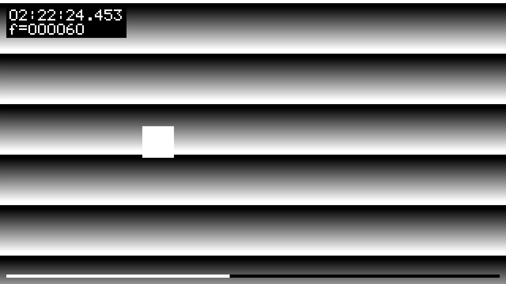

# llcast

[](https://github.com/CallMeKevinFeng/llcast/actions/workflows/build.yml)
[](LICENSE)

低延迟音视频管线实验项目：用 C + FFmpeg/libav 从零搭建 **V4L2 采集 → H.264 编码 → WebRTC 出流** 的完整链路，目标是把局域网玻璃到玻璃延迟压到 300ms 以内，并给出可复测的弱网数据。

A low-latency A/V pipeline in C: V4L2 capture → NVENC/x264 → (roadmap) RTP/WHIP.

## 架构

```
V4L2 camera ──NV12──┐
                    ├──▶ libav encoder ──▶ Annex B ──▶ [next] RTP / WHIP
synthetic frames ───┘   h264_nvenc / libx264
```

摄像头只给 YUYV 时由 libswscale 转 NV12；无摄像头或打开失败时自动使用合成帧，方便在任何机器上验证管线。

## 进度

| 模块 | 状态 |
|---|---|
| V4L2 mmap 采集（NV12 / YUYV→NV12 / MJPEG 解码） | ✅ |
| H.264 编码（NVENC `p1`+`ll`，libx264 自动回退） | ✅ |
| Annex B 输出 + 每帧 submit+drain 耗时统计 | ✅ |
| 画面毫秒计时器（玻璃到玻璃实测） | ✅ |
| RTP 打包 + WHIP 入流 | ⬜ |
| 浏览器 WHEP 播放端 | ⬜ |
| 弱网矩阵（tc netem 丢包/抖动/限速） | ⬜ |

## 构建

依赖：CMake ≥ 3.16、FFmpeg 开发库（libavcodec / libavutil / libswscale）；NVENC 需要可用的 NVIDIA 驱动与 nv-codec-headers。

```bash
sudo apt install build-essential cmake pkg-config \
  libavcodec-dev libavutil-dev libswscale-dev ffmpeg

cmake -S . -B build -DCMAKE_BUILD_TYPE=Release
cmake --build build -j
```

## 运行

```bash
./build/llcast_encode                 # 合成帧
./build/llcast_encode /dev/video0     # 摄像头（v4l2-ctl --list-devices 查看设备）
ffplay out.h264                       # 回放输出
```

编码器选择顺序：`h264_nvenc` → `libx264`。前者要求 `nvidia-smi` 正常且进程能访问 `/dev/nvidia*`，否则自动回退。

采集侧支持 NV12、YUYV、MJPEG：NV12 直接喂编码器，YUYV 和 MJPEG 自动转成 NV12；摄像头打开失败时回退合成帧。

## 实测

环境：GTX 1080 Ti（GP102, Pascal）/ Ubuntu 26.04 LTS / FFmpeg 7.x

| 路径 | 分辨率 | submit+drain (avg) | 备注 |
|---|---|---|---|
| libx264 ultrafast | 1280×720 | ~1.3 ms | 无 GPU 回退路径（含计时器叠加） |
| h264_nvenc p1+ll | 1280×720 | 待桌面补测 | 需可访问 GPU |

> submit+drain 是编码/提交路径耗时，不等于玻璃到玻璃延迟。后者 = 采集 + 编码 + 网络 + 抖动缓冲 + 解码 + 渲染。

## 低延迟参数

- GOP = 30（1 秒），B 帧 = 0
- NVENC：`preset=p1`（最快）、`tune=ll`（低延迟）、`delay=0`、CBR 2 Mbps
- x264 回退：`preset=ultrafast`、`tune=zerolatency`、`annexb=1`

## 玻璃到玻璃计时

每帧在编码前把 `CLOCK_MONOTONIC` 时间（时:分:秒.毫秒）和帧号画进 Y 平面，底部有一条 1 秒扫描条。画面里的时间会被编码、传输、解码完整带到接收端，同机回环时「接收端此刻 − 画面时间」就是玻璃到玻璃延迟；跨设备测量需要先做两端时钟偏移校准。



## 设备说明（GTX 1080 Ti / GP102）

- NVENC 支持 H.264 / H.265 8-bit 编码，不支持 AV1（AV1 编码需 RTX 40 系及以后）
- Pascal 无 B 帧，编码画质为较老一代；低延迟场景 B 帧本来就要为 0
- 消费级卡并发 NVENC 会话数有限（约 3 路），多路转码时需注意

## 路线图

- [x] 采集 + 编码骨架
- [x] 毫秒计时器叠加
- [ ] 玻璃到玻璃实测与数据表
- [ ] RTP/WHIP 出流 + WHEP 播放
- [ ] 弱网矩阵与延迟/卡顿曲线
- [ ] 图传模式（嵌入式 / RK3588 / Jetson）

## 许可

[MIT](LICENSE) © 2026 CallMeKevinFeng
